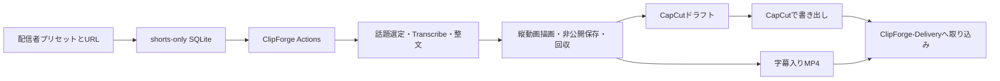

# 構成

```text
shorts-only/
  main.py                    # CLI入口
  run-windows.cmd            # 初回依存導入・Windows起動
  .env.example               # 接続先のパス。秘密は個人の.envへ
  config/
    streamers.example.yaml   # 配信者別デザイン、本数と形式の目安
    batch.example.yaml       # 並列依頼
  src/shorts_only/
    cli.py                   # run / batch / resume / draft / source / jobs / connect
    settings.py              # 個人設定と保存先
    store.py                 # SQLite、制作・再接続・ドラフトの時間記録
    clipforge.py             # 正規制作入口と既存Run回収
    timeline.py              # プレビュー・無音カット・字幕の時刻対応
    capcut.py                # pyCapCutドラフト・素材同梱
```



素材取得・話題選定・文字起こし・整文・リサイズ・MP4描画は既存ClipForgeに任せます。別の全文Whisper処理やモデルキー管理をこのリポジトリへ複製しません。Transcribeの原データと時刻・話者情報はClipForgeの出力に保持し、ドラフト側は元SRTと時刻対応から字幕を配置します。SRT単体には単語時刻や話者の構造化情報がないため、そこから補完はしません。

手元の元動画と区間が決まっていれば `source` で直接ドラフトを作れます。この経路ではClipForge・モデル・FFmpeg描画を呼ばず、CapCutの素材参照区間として保存します。既定では元動画をコピーせず元の絶対パスを参照するため、元動画の移動はCapCutの参照先にも影響します。

## 続行

1. `run` はSQLiteへ制作IDと依頼内容を保存し、ClipForgeに1回だけ指示します。
2. 指示済みURLを再指定しても、新たな制作を投入しません。`--new` で明示した場合は新規依頼です。
3. `resume` は保存済みproduction-stateに再接続します。成否不明のdispatchを自動再送しません。
4. 回収が完了し、CapCut設定や依存だけが不足している場合は `draft_pending` にします。
5. `draft --job ID` は回収済み動画を使用し、成功してフォルダが存在するドラフトを再利用します。元動画の再制作や再課金は発生しません。
6. FileLockで同一制作への操作を重ねません。別制作は `batch --workers 2` で並列にできます。これはClipForge内のAPI同時実行数とは別の上限です。

本数・尺・演出数を満たすまで繰り返す処理や、映像全体の品質監査はありません。制作に失敗した場合も回収済みファイルとログを残します。ドラフトは毎回新しい名前で作成し、既存のCapCutプロジェクトを上書きしません。

## 時間軸

`source_start/source_end` が元クリップ内の区間、`target_start/duration` がドラフト内の配置です。プレビューを先頭に加えて本編が3秒後に始まるなら、本編字幕も3秒後へ移します。明示的なカットや無音カットも同じ表を通します。

`jetcut: true` を配信者に指定すると、FFmpegで0.6秒以上の無音を抽出し、前後約0.12秒を残して本編区間を組みます。元ファイルは切り替えず、ドラフトの素材参照区間を変えます。実行できなければ理由を記録して元区間で続行します。「えー」など発声された言葉の自動削除ではありません。既定は追加音声解析なしです。

プレビューは最大3個・各約1秒です。字幕の感嘆表現による選択は `caption_heuristic`、ユーザー設定の秒数は `supplied_peaks` と記録します。Geminiへ追加要求を送ってピークを推定したことにはしません。

## 接続

- モデル・GPU: ClipForge側の登録済み接続を使用。SDKへの未確認の置換や別APIキーへの暗黙切替は追加しません。
- CapCut: PC内の明示的なドラフト保存先へ書き込み。クラウドのPro契約とは別です。
- Delivery: マニフェストと既存のインポート画面を介して渡します。別アプリのSQLiteへ直接書き込みません。
- 保存先: リポジトリ外の `~/.shorts-only` が既定。個人のURLや生成素材を公開Gitへ混ぜません。

## 実施した動作

Linux上でpyCapCut 0.0.4を使用し、6秒の合成素材から動画・編集可能字幕・3つのプレビューを含む9秒の `draft_content.json` を生成しました。固定ワイプ付きドラフトと、元動画をコピーせず指定区間を使うドラフトも生成しました。`--plan` と接続案内の表示も実行しました。CapCut Windowsでの表示、Pro素材の利用、実際のアーカイブからのモデル処理と本番書き出しは未実施です。ドラフト作成成功とCapCutでの互換性を混同しません。
